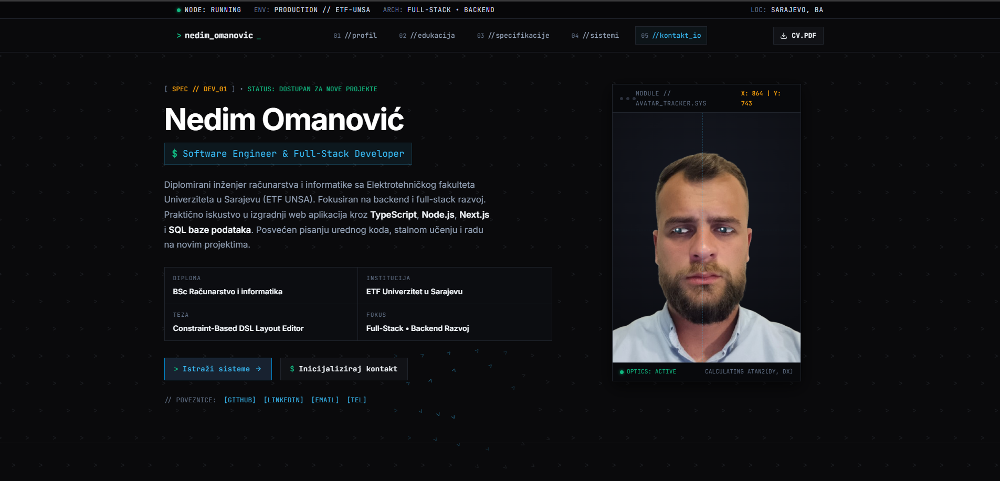

# Nedim Omanović — Personal Portfolio

Personal portfolio website presenting my education, technical skills, projects, and experience as a Software Engineer & Full-Stack Developer.

## Live Demo

[portofolio.nedimomanovic04.workers.dev](https://portofolio.nedimomanovic04.workers.dev/)

## Screenshots

## Features

- Terminal-inspired interface with a dark theme and technical status indicators
- Interactive canvas background with arrows that react to cursor movement
- Animated portrait with eye tracking, natural blinking, and contact reactions
- Dedicated sections for education, technical skills, projects, and contact information
- Project showcase with GitHub profile and live demo links
- Downloadable CV in PDF format
- Contact details with copy-to-clipboard functionality
- Smooth scrolling, scroll animations, and mobile navigation
- Responsive layout for desktop and mobile devices
- Favicon assets for browsers and mobile devices

## Tech Stack

- HTML5
- CSS3 (responsive layouts and animations)
- Vanilla JavaScript (no framework or build step)
- HTML Canvas API
- Intersection Observer API
- Clipboard API
- Google Fonts (Inter and JetBrains Mono)
- Cloudflare Workers (hosting)
- Git / GitHub

## What I Learned

- Building a responsive personal portfolio without a framework or bundler
- Creating interactive canvas animations driven by cursor movement
- Using trigonometry and interpolation for animated eye tracking
- Implementing scroll-triggered animations with Intersection Observer
- Adding clipboard interactions and visual feedback
- Designing a consistent terminal-inspired interface across screen sizes
- Publishing a static website on Cloudflare Workers
